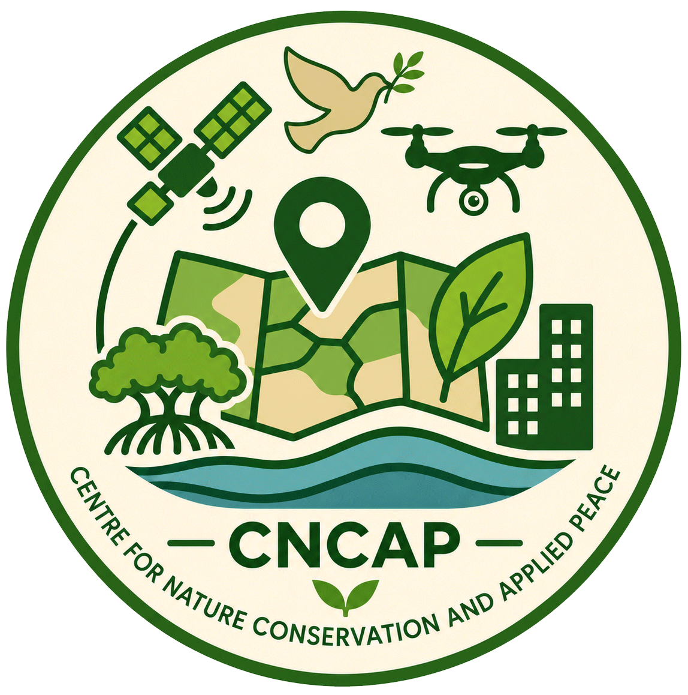

  

<h1 align="center">
  Centre for Nature Conservation and Applied Peace
</h1>

<h3 align="center">
  CNCAP
</h3>

  Research | Education | Technology | Sustainability | Peace

  <i>Advancing science, conserving nature and promoting peaceful coexistence.</i>

Welcome to the Centre for Nature Conservation and Applied Peace (CNCAP), an independent research and educational initiative based in Australia and Viet Nam.

CNCAP aims to advance nature conservation, environmental sustainability and peaceful coexistence between people and nature through scientific research, geospatial technology, open education, and interdisciplinary collaboration.

---

## Our Mission

- Advance scientific research in nature conservation and environmental sustainability.
- Develop open-source geospatial tools and reproducible scientific workflows.
- Promote accessible education in GIS, remote sensing and Earth observation.
- Apply artificial intelligence and emerging technologies to environmental challenges.
- Support interdisciplinary and international research collaboration.
- Promote peaceful and sustainable relationships between people and nature.

## Research Areas

| Research theme | Research focus |
| :--- | :--- |
| Nature Conservation | Biodiversity, ecosystems, and habitat monitoring |
| Earth Observation | Satellite imagery and environmental monitoring |
| Geospatial Science | GIS, spatial analysis, and spatial modelling |
| GeoAI | Machine learning, deep learning, and spatial intelligence |
| Coastal Environments | Mangroves, wetlands, and shoreline dynamics |
| Climate Change | Environmental change, adaptation, and resilience |
| InSAR | Land subsidence and surface deformation |
| Sustainable Development | Natural resource management and spatial planning |
| Applied Peace | Environmental cooperation and human–nature coexistence |

## Technologies and Tools

## Open Research and Education

Our GitHub platform is being developed to provide:

- Open-source scientific code
- Geospatial analysis workflows
- Python notebooks
- Google Earth Engine scripts
- Machine learning and deep learning applications
- Remote sensing tutorials
- Research documentation
- Educational resources

## GIS Application – YouTube

GIS Application is our educational YouTube channel, dedicated to practical tutorials and scientific applications in GIS, remote sensing, Earth observation, and geospatial programming.

Future video tutorials will be accompanied by source code, documentation and supporting materials through our GitHub repositories.

## Founder

**Dr Thuong Tran**

PhD in Geospatial Sciences, Monash University, Australia.

Research interests include remote sensing, GIS, Earth observation, coastal ecosystems, spatial modelling, GeoAI, and environmental monitoring.

Recipient of the 2025 Esri Australia Young Scholar Award.

## Collaboration

CNCAP welcomes opportunities for collaboration with researchers, educators, students, practitioners and institutions interested in environmental science, geospatial technology, nature conservation, and sustainable development.

## Connect with Us

- GitHub: [CNCAP-Research](https://github.com/CNCAP-Research)
- YouTube: [GIS Application](https://www.youtube.com/@gisapplication70)
- Location: Melbourne, Australia

---

*Advancing science, conserving nature, and promoting peaceful coexistence.*

© 2026 Centre for Nature Conservation and Applied Peace (CNCAP)
